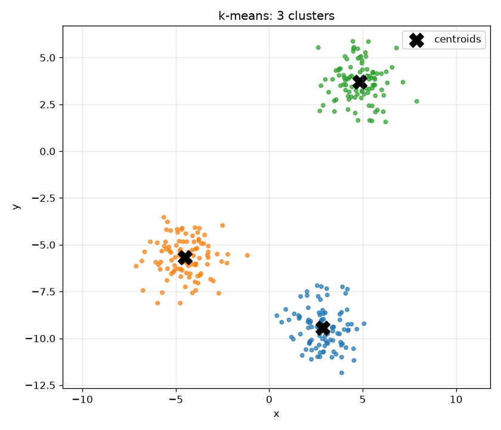
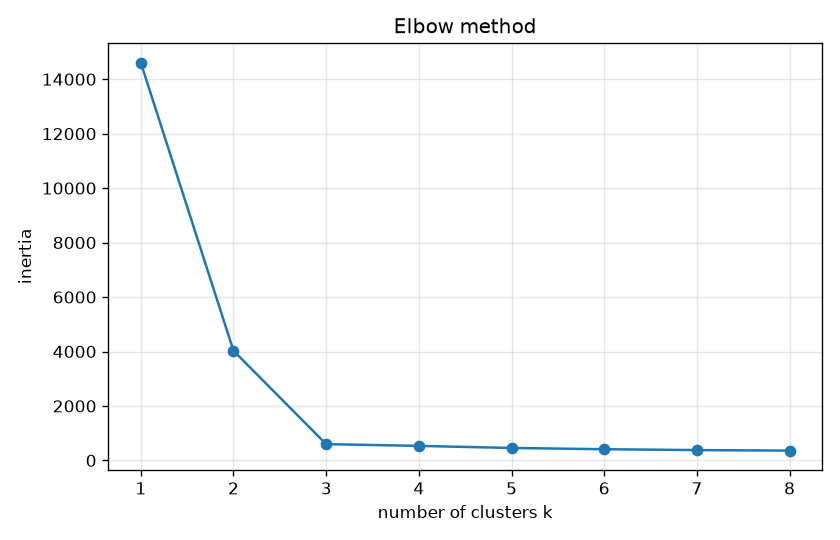

# Segmenta

[](https://github.com/sseusti/segmenta/actions/workflows/ci.yml)

Кластеризация методом k-средних (k-means) на чистом Python.

Лабораторная работа 1 по курсу Python 2026, трек Data Science, тема А2.

Программа генерирует синтетические 2D-данные вокруг случайных центров,
разбивает их на `k` кластеров и печатает размеры кластеров и inertia.
Умеет строить график кластеров и подбирать `k` методом локтя.
Ядро алгоритма написано на списках, без `numpy` и `sklearn`.



## Установка

Нужны Python 3.12+ и [uv](https://docs.astral.sh/uv/).

```bash
git clone https://github.com/sseusti/segmenta.git
cd segmenta
uv sync
```

## Запуск

```bash
uv run python kmeans.py --samples 300 --k 3 --iter 100 --seed 42
```

```
Clustered 300 points into 3 clusters in 4 iterations
  cluster 0: 100 points, center (2.87, -9.46)
  cluster 1: 100 points, center (-4.50, -5.68)
  cluster 2: 100 points, center (4.83, 3.70)
Inertia: 597.64
```

Та же программа доступна как команда `uv run kmeans ...`.

### Аргументы

| Аргумент | По умолчанию | Описание |
| --- | --- | --- |
| `--samples` | 300 | число точек |
| `--k` | 3 | сколько кластеров искать |
| `--centers` | 3 | сколько истинных центров использовать при генерации данных |
| `--iter` | 100 | максимальное число итераций |
| `--sigma` | 1.0 | разброс точек вокруг центра |
| `--seed` | — | seed для воспроизводимости |
| `--plot PATH` | — | сохранить график кластеров |
| `--elbow [PATH]` | `elbow.png` | метод локтя: inertia для k = 1..`--k-max` и график |
| `--k-max` | 10 | наибольшее k для метода локтя |

Некорректные аргументы дают понятное сообщение и код выхода 2:

```
$ uv run python kmeans.py --samples 2 --k 3
kmeans: error: number of points must be at least n_clusters
```

### Визуализации

```bash
uv run python kmeans.py --seed 42 --plot clusters.png --elbow elbow.png --k-max 8
```

Метод локтя: inertia резко падает до k = 3 и дальше почти не меняется.
Это совпадает с числом центров, из которых сгенерированы данные.



## Как работает алгоритм

1. **Инициализация**: в качестве начальных центров берутся `k` случайных
   разных точек (`random.Random(seed)`).
2. **Assign**: каждая точка относится к ближайшему центру (квадрат
   евклидова расстояния).
3. **Update**: каждый центр сдвигается в среднее своих точек. Если кластер
   остался пустым, центр не меняется.
4. Шаги 2–3 повторяются, пока центры не перестанут сдвигаться (сдвиг ≤ `tol`)
   или не кончится `max_iter`.

Качество разбиения измеряется **inertia**: суммой квадратов расстояний от
точек до их центров. Ни шаг assign, ни шаг update её не увеличивают, поэтому
inertia монотонно не растёт, а алгоритм сходится, хотя и к локальному минимуму.

## Структура

```
src/segmenta/
├── aliases.py   # тип Point = list[float]
├── data.py      # генерация данных: make_centers, make_blobs
├── core.py      # sq_dist, mean, класс KMeans, elbow
├── plot.py      # графики кластеров и метода локтя (matplotlib)
└── cli.py       # аргументы командной строки
kmeans.py        # точка входа: python kmeans.py ...
tests/           # pytest
```

Основной API:

```python
from segmenta.core import KMeans
from segmenta.data import make_blobs

points, _ = make_blobs(300, [[0.0, 0.0], [10.0, 10.0], [-10.0, 5.0]], seed=42)
model = KMeans(n_clusters=3, seed=0)
labels = model.fit(points)
model.centroids_  # найденные центры
model.inertia_history_  # inertia по итерациям
model.predict([[0.5, 0.2]])
```

## Тесты и качество кода

```bash
uv run pytest                 # тесты
uv run ruff check .           # линтер
uv run ruff format --check .  # форматирование
uv run mypy                   # проверка типов (strict)
```

Тесты проверяют, что:
- k-means находит 3 известных центра;
- inertia не растёт с итерациями;
- одинаковый seed даёт одинаковый результат;
- разные `k` дают разное число кластеров;
- ошибки аргументов обрабатываются корректно;
- графики сохраняются;
- метод локтя показывает излом на истинном `k`.

Все проверки запускаются в GitHub Actions на каждый push и локально через
pre-commit:

```bash
uv run pre-commit install
```
